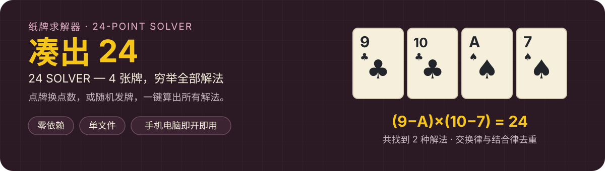
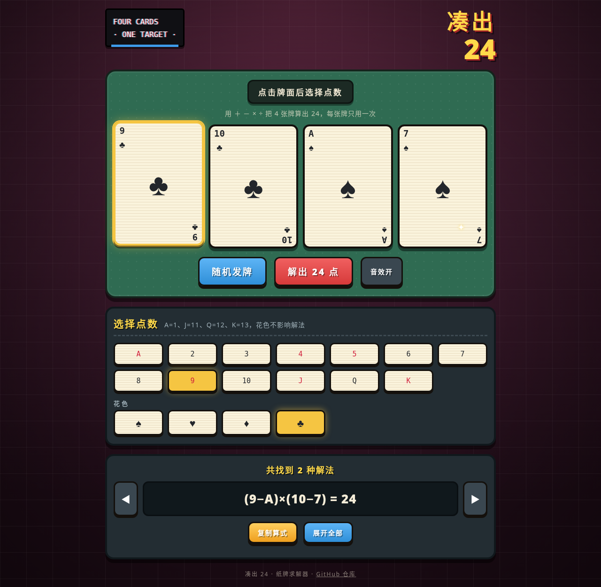

<a href="README.md">中文</a>

  

  <a href="https://xiaosang.cc/24-solver/">▶ Live Demo</a>
  ·
  <a href="https://github.com/holynova/24-solver">GitHub Repository</a>

24 Solver is a zero-dependency, single-file web app for the 24-point card puzzle: enter any four card ranks and it enumerates every solution that makes 24, deduplicated by commutativity and associativity. It opens instantly in any mobile or desktop browser.

## Screenshot

  

## How to Use

1. Tap a card and pick its rank below (A=1, J=11, Q=12, K=13; suits don't affect solutions) — or tap 「随机发牌」 ("Deal") for a random hand.
2. Tap 「解出 24 点」 ("Solve") to get every solution.
3. Flip through solutions with ◀ ▶, tap 「复制算式」 ("Copy expression") to copy the current expression, or 「展开全部」 ("Expand all") to see them at once.

## Features

- **Exhaustive search**: every permutation and operator combination of the four cards is checked, then deduplicated by commutativity and associativity — no missing solutions, no duplicates.
- **Tap a card to change it**: tap any card to change its rank or suit; the suit only affects how the card looks, not the solutions.
- **Random deal**: deal four new cards with one tap.
- **Browse solutions**: flip through them, copy the expression, or expand all at once.
- **Pixel card table**: rainbow-foil card faces, flip animations, and synthesized WebAudio sound effects (can be muted).

## Run Locally

A single file with zero dependencies and no build step — just open `index.html`.

## Tech

- All logic lives in one `index.html`: exhaustive search plus algebraic deduplication, pure frontend — no backend, no network requests.
- Card faces are drawn with CSS; sound effects are synthesized with WebAudio, so there are no audio files.
