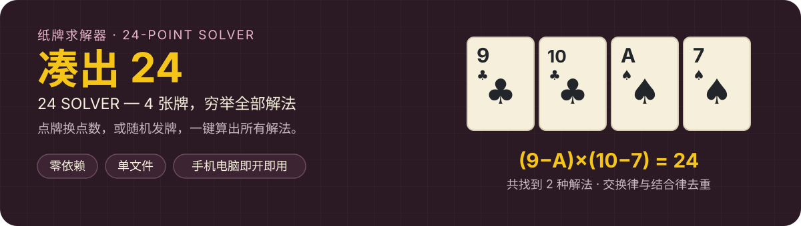
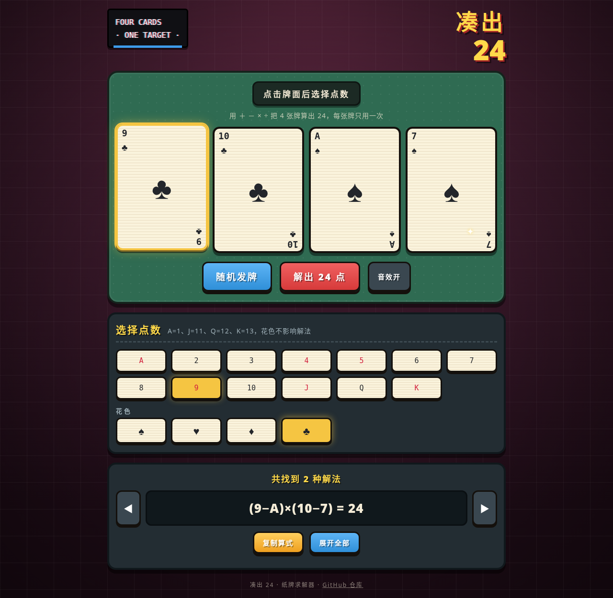

<a href="README.en.md">English</a>

  

  <a href="https://xiaosang.cc/24-solver/">▶ 在线体验</a>
  ·
  <a href="https://github.com/holynova/24-solver">GitHub 仓库</a>

凑出 24 是一款单文件网页版 24 点纸牌求解器：输入任意 4 张牌的点数，穷举全部解法，并按交换律与结合律去重。零依赖，手机与电脑浏览器即开即用。

## 截图

  

## 怎么用

1. 点一张牌，在下方选点数（A=1、J=11、Q=12、K=13，花色不影响解法）；或点「随机发牌」。
2. 点「解出 24 点」，即得全部解法。
3. 用 ◀ ▶ 翻页查看每种解法，点「复制算式」复制当前算式，点「展开全部」一次看完。

## 功能

- **穷举全部解法**：4 张牌的所有排列与运算符组合逐一验算，按交换律与结合律去重，不漏解、不重复。
- **点牌换点数**：点任意一张牌换点数与花色；花色只影响牌面显示，不影响解法。
- **随机发牌**：一键发 4 张新牌。
- **解法浏览**：翻页查看、复制算式、展开全部。
- **像素纸牌界面**：彩虹流光牌面、翻牌动画、WebAudio 合成音效（可关）。

## 本地运行

单文件，零依赖、零构建，直接打开 `index.html` 即可。

## 技术

- 全部逻辑在一个 `index.html` 里：穷举搜索 + 代数去重，纯前端，无后端、无网络请求。
- 牌面用 CSS 绘制，音效用 WebAudio 合成，无音频文件。
